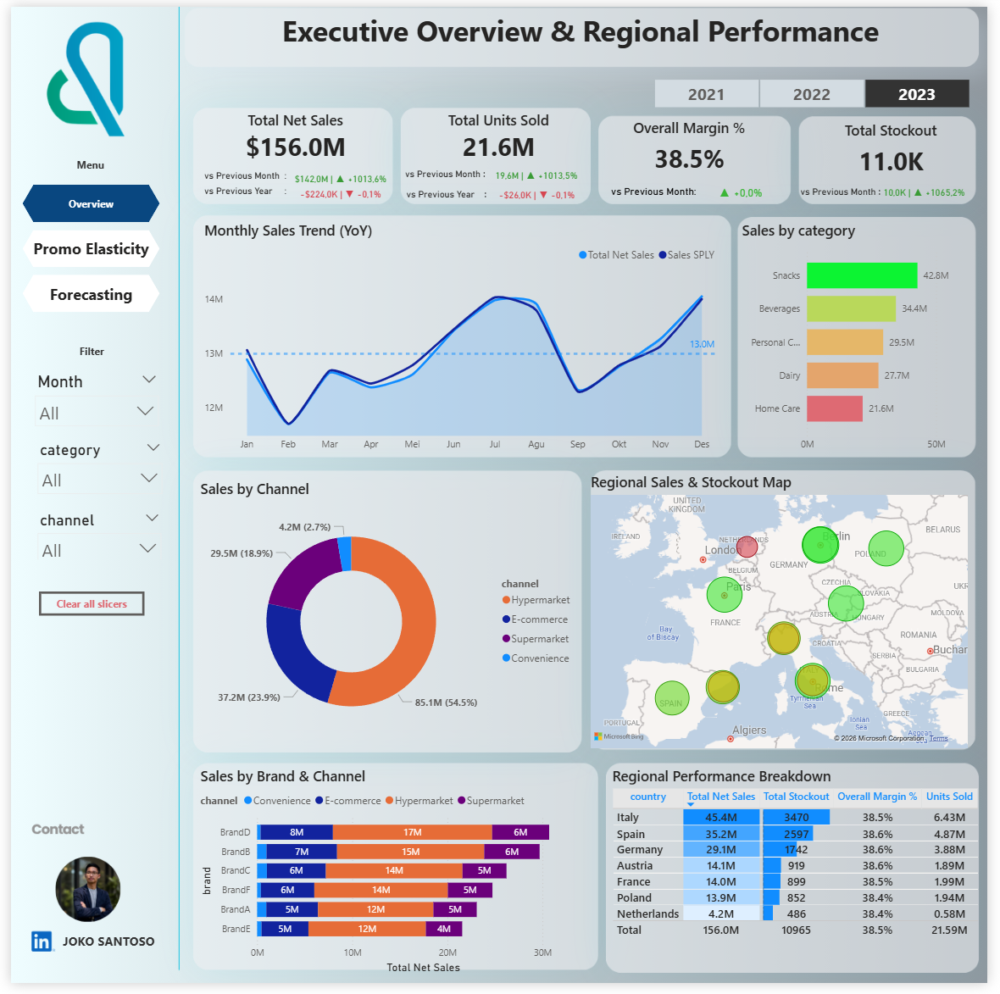
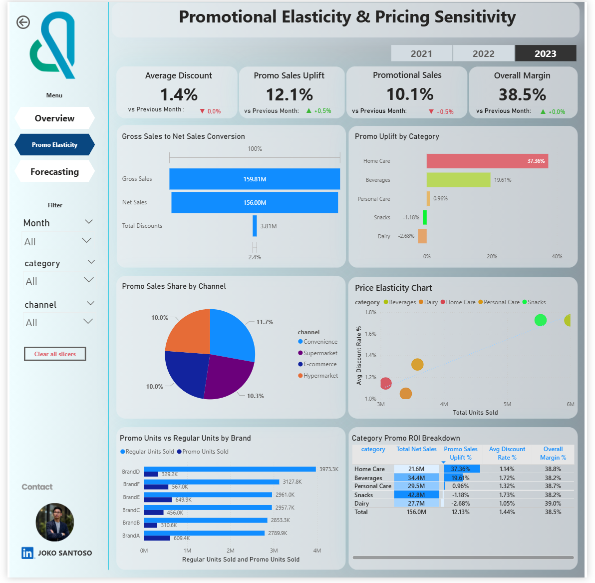
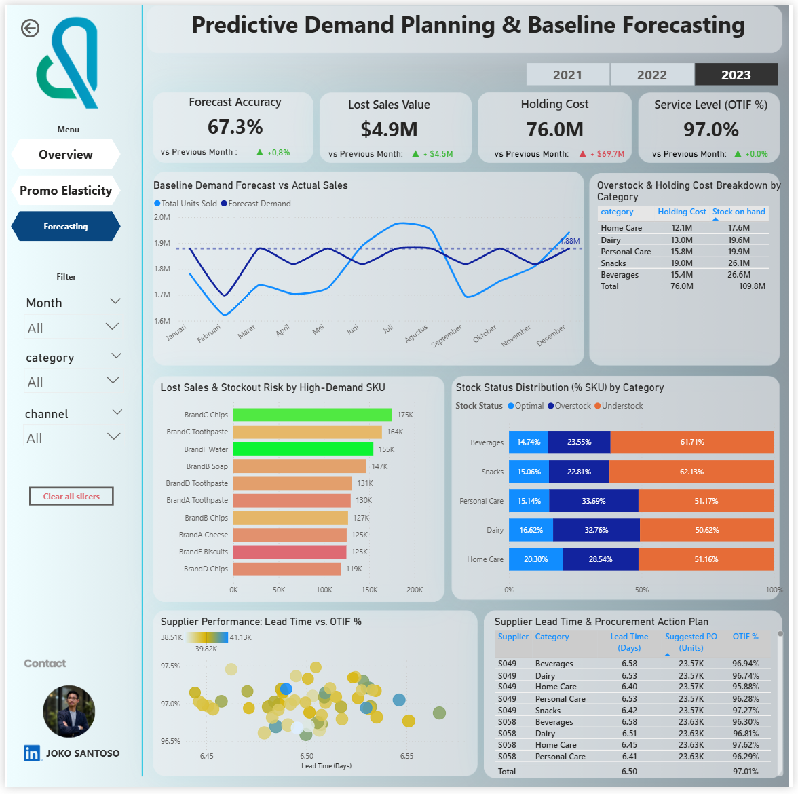

# Global FMCG Retail Inventory Optimization & Predictive Demand Planning

> **End-to-End Business Intelligence, Multi-Country Supply Chain Analytics, Inventory Segmentation (ABC-XYZ), Promotional Elasticity, & Predictive Demand Forecasting in Python.**

---

##  Project Overview
Proyek ini mengimplementasikan kerangka kerja analitik tingkat lanjut (*Advanced Analytics*) untuk menyelesaikan tantangan operasional dan finansial pada industri *Fast-Moving Consumer Goods* (FMCG) multinasional. Analisis ini dirancang secara *end-to-end* guna memitigasi risiko kekurangan stok (*stockout*), menekan modal tertahan (*capital tied-up*), serta mengoptimalkan efektivitas strategi promosi dan peramalan permintaan.

---
## Executive BI Dashboard Previews

Proyek ini dilengkapi dengan 3 halaman utama *Interactive Executive Dashboard* yang dirancang untuk memonitor kesehatan rantai pasok dan efektivitas komersial secara *real-time*:

### 1. Executive Overview & Regional Performance (Page 1)
> Menyajikan ringkasan metrik utama perusahaan (*Net Sales*, *Units Sold*, *Overall Margin*, dan *Stockout Incidents*), serta peta sebaran kinerja regional di mana **Italy** dan **Spain** teridentifikasi sebagai kontributor terbesar sekaligus hotspot stockout.



### 2. Promotional Elasticity & Pricing Sensitivity (Page 2)
> Memonitor efektivitas program diskon dan promosi aktif, mengidentifikasi kategori produk *Margin Killers* (inelastis dengan erosi marjin rata-rata **18.66%**), serta memberikan panduan alokasi anggaran komersial yang lebih profitabel.



### 3. Predictive Demand Planning & Baseline Forecasting (Page 3)
> Menampilkan baseline peramalan tren permintaan harian (*Rolling Moving Average*), sebaran distribusi status SKU (*Understock* vs *Overstock*), serta analisis performa pemasok untuk mendukung keputusan operasional *S&OP*.




##  Analytical Pillars (The 4 Pillars Framework)

### 1. Data Architecture & Master Table Standardization
* **Data Cleansing:** Membersihkan nilai ekstrem/outlier pada kolom transaksi (seperti `units_sold` negatif dan anomali `gross_sales`) serta menangani nilai kosong (*missing values*) menggunakan imputasi median statistik.
* **Master Table Integration:** Menghasilkan *Single Source of Truth* bersih yang siap diintegrasikan ke dalam dashboard eksekutif (Power BI / Tableau) dengan total **1.100.000 baris** data transaksional lintas 7 negara Eropa.

### 2. Operational BI & Regional Performance Analytics
* **Geographical Performance:** Memetaan kontribusi *net sales* dan volume penjualan per negara, di mana **Italy** dan **Spain** memimpin sebagai pasar terbesar sekaligus wilayah konsentrasi *stockout* tertinggi.
* **Stockout Impact Quantification:** Menghitung kerugian finansial akibat *lost sales* dan *lost revenue* secara global yang mencapai **~$14.88 Juta**.
* **Inventory & ABC-XYZ Segmentation:** Menerapkan analisis Pareto (ABC) dan koefisien variasi permintaan (XYZ) untuk mengidentifikasi produk *Slow-Moving* (Kategori C) yang memicu penumpukan modal di gudang (*Capital Tied-Up*).

### 3. Promotional Impact & Pricing Sensitivity Analysis
* **Promotional Lift:** Mengevaluasi lonjakan volume penjualan saat promosi aktif yang mendongkrak transaksi dari ~55 unit menjadi ~102 unit per transaksi.
* **Margin Trade-off & Margin Killers:** Mengidentifikasi erosi marjin laba rata-rata sebesar **18.66%** akibat diskon langsung. Melalui analisis *Price Elasticity of Demand* (PED), ditemukan bahwa kategori seperti *Home Care* dan *Beverages* bersifat inelastis (PED < 1.0), di mana diskon merusak profitabilitas tanpa mendongkrak volume secara signifikan.

### 4. Predictive Demand Planning & Business Intelligence KPI Report
* **Time Series Forecasting:** Membangun *Rolling Moving Average* (30-Hari) untuk meredam volatilitas harian dan memetakan pola musiman.
* **Machine Learning Model:** Melatih model *Linear Regression* untuk peramalan permintaan harian dengan tingkat akurasi tinggi (**MAPE: 7.41%**, **WAPE: 7.80%**).
* **S&OP Action Plan:** Menyusun rekomendasi kebijakan *Safety Stock* (SS) dan *Reorder Point* (ROP) berbasis *service level* 95% untuk mendukung keputusan operasional rantai pasok.

---

##  Tech Stack & Libraries
* **Language:** Python
* **Data Manipulation & Analysis:** Pandas, NumPy
* **Data Visualization:** Matplotlib, Seaborn
* **Machine Learning & Metrics:** Scikit-Learn (Linear Regression, Train-Test Split, MSE, MAPE, WAPE)
* **Environment:** Google Colab & Google Drive

---

##  Repository Structure
```text
├── Global FMCG Retail Inventory Optimization & Predictive Demand Planning.ipynb  # Main End-to-End Notebook
├── dataset/                                                                    # Raw & Cleaned CSV data files
└── README.md                                                                   # Project Documentation
```


## Key Business Recommendations
1. **Targeted Diskon:** Hentikan diskon langsung pada kategori produk inelastis (*Margin Killers*) dan alihkan anggaran promosi ke produk yang responsif secara elastisitas.
2. **Optimalisasi Safety Stock:** Terapkan kontrol inventaris berbasis *Min-Max* dan *Reorder Point* di hub logistik Eropa Selatan untuk menekan angka *lost revenue* di Italia dan Spanyol.
3. **Proactive S&OP:** Manfaatkan model peramalan permintaan harian berbasis regresi linier untuk menyelaraskan kapasitas produksi pabrik dengan proyeksi tren musiman.

---

---

## 👤 Author & Professional Profile
* **Author:** Joko Santoso
* **Role:** Senior Business Intelligence & Data Analytics Professional
* **Slide:** [Presentation by canva](https://canva.link/bgc986gigngcxqj)
* **Email:** [santosoj160@gmail.com](mailto:santosoj160@gmail.com)
* **LinkedIn:** [Joko Santoso on LinkedIn](https://www.linkedin.com/in/joko-santoso160)
* **Focus:** Advanced Data Analytics, Supply Chain Optimization, Predictive Modeling, & Executive BI Dashboards.
